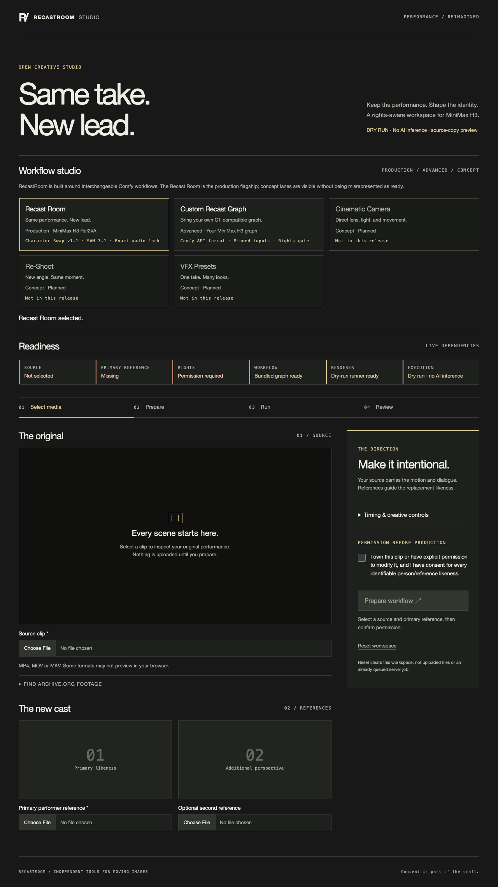

# RecastRoom Studio

```text
Same take. New lead.
```

RecastRoom Studio is an open-source creative workspace built around **MiniMax H3 Ref2VA**, **ComfyUI**, interchangeable Comfy API workflows, and performance-preserving character replacement. Its supported app and CLI paths require a recorded operator attestation before generation; RecastRoom does **not** verify legal rights, ownership, consent, model licensing, or clearance.

Public-brand rationale and collision evidence: [`docs/BRANDING.md`](docs/BRANDING.md).

It is a practical answer to Comfy's **#OpenSourceHiggsfield** challenge: turn the expensive “put a different performer into this clip” workflow into a reproducible app people can run, inspect, fork, and improve.

## What it does

RecastRoom Studio helps you:

1. inspect a source clip you own or are licensed to use,
2. reject risky or low-quality shot candidates before GPU time is spent,
3. transcribe word timings with Whisper,
4. build an H3 character-swap prompt,
5. run the production **Recast Room** workflow or import a C1-compatible Comfy API graph,
6. restore the original dialogue,
7. produce a source/final review artifact.

The studio presents a workflow catalog. The **Recast Room** is the production flagship; cinematic camera, re-shoot, and VFX lanes are clearly labeled concepts rather than fake ready features.

The bundled local workflow uses the C1 V4 performance-preserving graph:

- MiniMax H3 Ref2VA
- BFSShotH3ConditioningSimple
- Character Swap LoRA v1.1 at `1.0`
- Head Swap disabled
- 8-step Turbo
- `source_blur=head + hands (keep mouth)`
- SAM 3.1 source segmentation
- source-audio conditioning
- MiniMax H3 Exact Audio Lock
- exact word/frame schedule

## Three surfaces

| Route | Purpose |
|---|---|
| `/landing.html` | Public overview with the accepted 23.8-second v6b proof in the hero |
| `/` | Production workspace: source, references, attestation, workflow, renderer, and review |
| `/sound-lab.html` | Keeper-video review plus the local Tone.js cue family |
| `/legal.html` | Local-demo privacy, terms, and rights responsibilities |

The public hero is a metadata-clean stream copy of the accepted v6b master. Its video and audio packet MD5 values match the frozen source, while its distributable file hash is:

```text
2cabf3066c5bfe9fcdfc5ee760ea94519b87b8a1f96f268f4fe464e48bd08b88
```

## Status

This repository is intentionally published as a working research application, not a polished commercial service.

The current milestone includes:

- key-free Archive.org source discovery with license metadata; metadata is discovery evidence, not legal clearance,
- a Seriesmith-inspired live readiness strip for source, references, rights, workflow, renderer, and execution mode,
- parameterized workflow builder,
- Whisper timing parser,
- media probe and pre-flight report,
- recorded operator attestation handling,
- local ComfyUI API runner,
- FastAPI web UI,
- review artifact helpers,
- tests for prompt/timing/workflow mutation.

The synthetic production milestone is complete:

- Seed 50 Jay core swap: human-approved, Qwen overall `9/10`.
- Eleven keeper candidates covering every approved format concept.
- Actual browser-driven app walkthrough and prepared-job API response.
- Demo v1: `108.052s`, `1152×768`, `−17.15 LUFS`, `−1.50 dBTP`.

The current local package also includes:

- the accepted v6b public landing surface,
- a three-result proof gallery using synthetic keeper comparisons,
- runtime and cost boundaries for dry run, local ComfyUI, and official SDK execution,
- setup diagnostics and a focused comparison table on the public landing page,
- honest roadmap cards for multi-person casting, scene/effect recipes, and take-level production state,
- a purpose-built 9:16 evidence-timeline candidate,
- the local Tone.js sound-design lab,
- 126 automated tests.

CI is defined in `.github/workflows/ci.yml` for Python 3.11 and 3.12. It installs FFmpeg, compiles Python sources, checks browser JavaScript, and runs the full test suite.

The official Comfy SDK execution adapter is implemented and installs cleanly,
but live hosted execution still requires a configured Comfy Developer Platform
deployment and `COMFY_API_KEY`.

## Screenshots

| App and readiness | Prepared job |
|---|---|
|  |  |

Readiness detail: [`docs/images/readiness-visual.png`](docs/images/readiness-visual.png)

Full walkthrough contact sheet: [`docs/images/app-walkthrough.jpg`](docs/images/app-walkthrough.jpg)

Demo storyboard: [`docs/images/demo-v1-contact.jpg`](docs/images/demo-v1-contact.jpg)

## Quickstart

Install FFmpeg first. macOS users can run `brew install ffmpeg`; Ubuntu users can run `sudo apt-get install ffmpeg`.

The reviewer-facing clean-checkout path is documented in
[`docs/QUICKSTART.md`](docs/QUICKSTART.md). The local smoke gates and archive
receipts are in [`docs/RELEASE.md`](docs/RELEASE.md). HTTP examples are in
[`docs/API_EXAMPLES.md`](docs/API_EXAMPLES.md).

```bash
python -m venv .venv
source .venv/bin/activate
python -m pip install ".[dev]"

export RECASTROOM_COMFY_URL="http://127.0.0.1:8188"
export RECASTROOM_WORKFLOW="workflows/openjutsu_h3_lipsync_local.json"

uvicorn app.main:app --reload --port 8768
```

Open:

```text
http://127.0.0.1:8768
```

The public overview is at `/landing.html`; the sound-design review surface is at `/sound-lab.html`.

## CLI

After installing the package, use the `recastroom` entry point. The Python
module and bundled workflow filename retain the legacy `openjutsu` identifier
for compatibility with validated receipts.

Inspect a clip:

```bash
recastroom inspect path/to/source.mp4
```

Extract word timings with local Whisper:

```bash
recastroom words path/to/source.mp4 --json path/to/words.json
```

Prepare a runnable workflow:

```bash
recastroom prepare \
  --attest-rights \
  --source source.mp4 \
  --reference-1 character-front.png \
  --reference-2 character-three-quarter.png \
  --identity "the target performer shown in the reference images" \
  --words words.json \
  --output work/prepared.json
```

Queue to a local ComfyUI API:

```bash
recastroom run --attest-rights work/prepared.json
```

The CLI also requires `--attest-rights` before queueing a workflow. This records your representation; it does not investigate ownership or prove consent.

## Architecture

```text
source clip
  -> scene and timing preflight
  -> authorized references
  -> recorded operator attestation
  -> C1-compatible MiniMax H3 workflow
  -> local ComfyUI or official Comfy SDK runner
  -> original-audio restoration
  -> source/final review artifact and evidence manifest
```

The FastAPI app owns validation and job state. The web client reports readiness and review state without claiming an automated quality score. FFmpeg handles probing, remuxing, and review renders. The bundled workflow keeps identity, performance, scene, and audio as separate responsibilities.

## Rights policy

RecastRoom Studio is for clips you own, clips you are licensed to use, or clips you have explicit permission to modify.

The UI requires an operator attestation before a job can start. The repository must not ship:

- unlicensed film or television footage,
- celebrity or public-figure likenesses without consent,
- clips of deceased performers without estate consent,
- non-consensual sexual, political, harassing, or deceptive media.

See `docs/RIGHTS.md` and `examples/RIGHTS_ATTESTATION.md`.

## Troubleshooting

| Symptom | Fix |
|---|---|
| `Renderer disconnected` | Start ComfyUI and confirm `RECASTROOM_COMFY_URL` points to it |
| Preparation returns 422 | Check that the source is a supported video and the rights box is checked |
| Whisper timing fails | Confirm the CLI can read the file and that it contains audible speech |
| Browser preview is blank | Use an MP4 or MOV preview; server preflight can still inspect other supported containers |
| SDK run reports missing credentials | Set `COMFY_API_KEY` and `COMFY_BASE_URL` for the configured deployment |

## Limitations

- RecastRoom does not prove legal clearance; it records your attestation.
- The public demo path still requires rights-clear source footage and references.
- Hosted Comfy SDK execution needs owner credentials and a configured deployment.
- Visual and audio quality remain human review gates; no automated score replaces playback.
- The current production graph is tuned for one-person continuous dialogue shots, not arbitrary multi-shot scenes.

## Contest alignment

RecastRoom Studio is being prepared for Comfy's #OpenSourceHiggsfield challenge
as **one focused, performance-preserving MiniMax H3 recasting studio**: one
owned or licensed continuous dialogue shot, authorized references, word-level
timing, original-audio restoration, rights gating, and a reproducible Comfy
workflow. It is not an attempt to recreate every feature of a broad commercial
video platform.

The current assessment and exact owner blockers are in
[`docs/evidence/OJ-g2xx/REPORT.md`](docs/evidence/OJ-g2xx/REPORT.md); the
contest-facing checklist is [`docs/SUBMISSION_CHECKLIST.md`](docs/SUBMISSION_CHECKLIST.md).
MiniMax H3 Ref2VA remains the core model required for the H3 bonus path.

The public demo must use owned, licensed, or original footage. The private film/TV experiments that informed the workflow will not be included in the repository.
