# RecastRoom Studio

```text
Same take. New lead.
```

RecastRoom Studio helps you prepare and review a one-person MiniMax H3 recast
for a clip you have permission to edit. The workflow keeps the source take and
dialogue schedule attached and restores source audio in the review output; final
identity, scene, and motion quality still require human review. The default
launcher starts in a no-GPU preview mode, while generation requires a connected
ComfyUI or hosted Comfy deployment.

[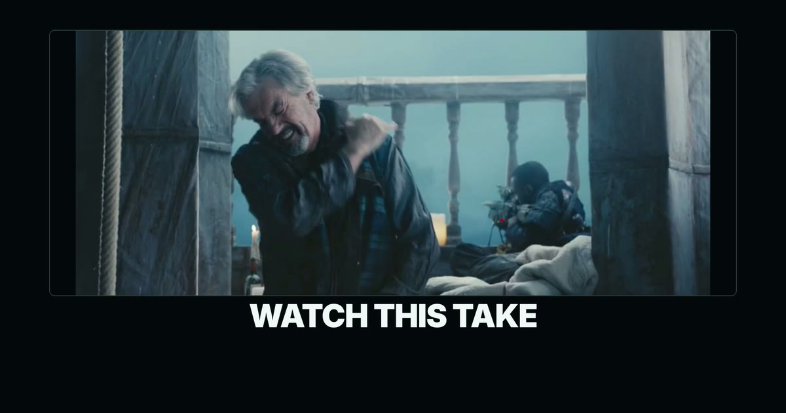](media/recastroom-public-hero-16x9.mp4)

## See it work

Inline animated previews:

| Studio walkthrough | Result preview |
|---|---|
| 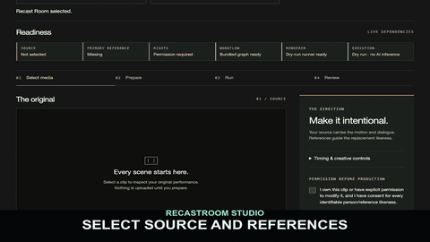 | 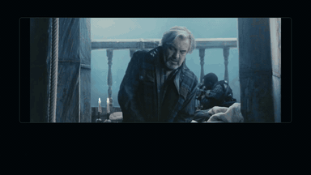 |

The current studio tour shows the guided path:

1. finish the four-choice setup,
2. inspect the source and add the primary reference,
3. record permission,
4. prepare and run the no-GPU preview,
5. review the paired result and downloads.

The result preview shows a recorded example. A new production still needs your
manual review before publication.

Full-length version: [`recastroom-user-journey-8s-16x9.mp4`](media/recastroom-user-journey-8s-16x9.mp4)

### Vertical preview

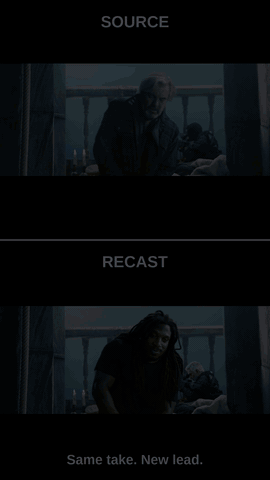

RecastRoom Studio is a practical answer to Comfy's **#OpenSourceHiggsfield**
challenge: turn “put a different performer into this clip” into a reproducible
local app that people can run, inspect, fork, and improve.

## What it does

RecastRoom Studio helps you:

1. review an original clip you own or have permission to edit,
2. probe duration, dimensions, frame rate, and audio before connecting a renderer,
3. add the new lead and dialogue timing,
4. prepare the RecastRoom MiniMax H3 job,
5. run locally or through a compatible Comfy setup,
6. keep the original dialogue,
7. compare the before and after result.

The guided workspace exposes the available path: one-person continuous dialogue
recast. Advanced project tools remain available for scene, take, review, and
export history.

The bundled workflow is designed to keep these signals attached:

- the original performance,
- camera and background,
- dialogue timing,
- the new performer’s identity,
- a paired source/final review.

Attachment does not guarantee output quality. RecastRoom deliberately provides
review media instead of claiming an automated quality score.

Exact model files and settings are documented in [`MODELS.md`](MODELS.md).

## The production workspace

After a one-time setup, RecastRoom opens into one workspace for reviewing the
original clip, adding the new lead, confirming permission, preparing the job,
and checking a result.

The public overview, sound-design review tool, and legal notes are support
pages linked from the app footer. They are not separate products or separate
user journeys.

The public media kit records the specification and SHA-256 hash for each
downloadable video and poster in [`media/README.md`](media/README.md).

## Production scope

RecastRoom Studio is a local-first production preview for one-person,
continuous-shot dialogue recasting. It is not a general-purpose hosted video
suite.

Included:

- one studio workspace
- a no-GPU preview path
- connection to your local ComfyUI renderer
- hosted Comfy connector for compatible deployments
- Whisper-compatible dialogue timing
- a permission checkpoint
- media checks and paired before/after review
- public overview and local review tools
- automated application, API, workflow, and browser tests

CI runs on Python 3.11 and 3.12 and executes the full test suite.
Detailed release status is recorded in [`docs/RELEASE_STATUS.md`](docs/RELEASE_STATUS.md).

Out of the box, `./run.sh` starts in preview mode: it can inspect media, prepare
a job, copy the source, and produce review files without a GPU or model
credentials. Preview output is not an H3 recast. Set `RECASTROOM_BACKEND=legacy`
to submit to ComfyUI. Hosted mode additionally requires a compatible deployment
containing the RecastRoom bridge and models, API credentials, and explicit
bridge configuration.

## User interface

| Guided workspace | Check readiness | Prepared job |
|---|---|---|
| 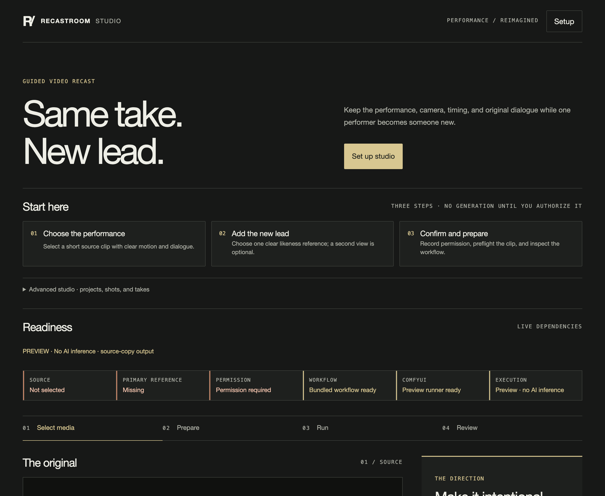 | 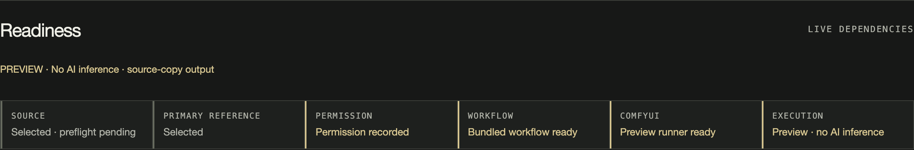 | 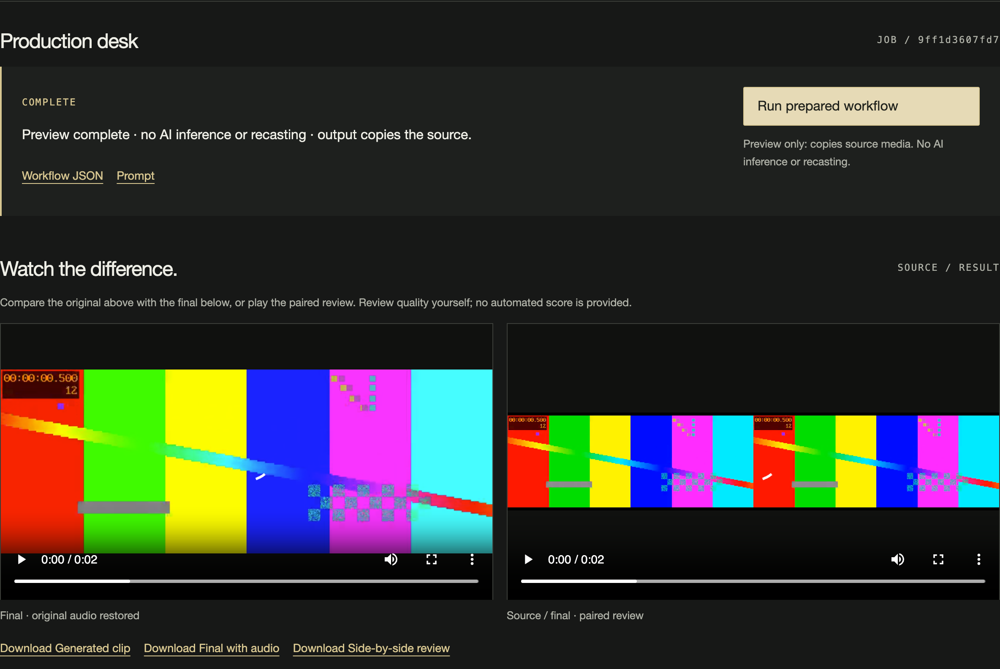 |

## Downloadable media

### Full-length showreel

[](media/recastroom-showreel-24s-16x9.mp4)

### Vertical result

[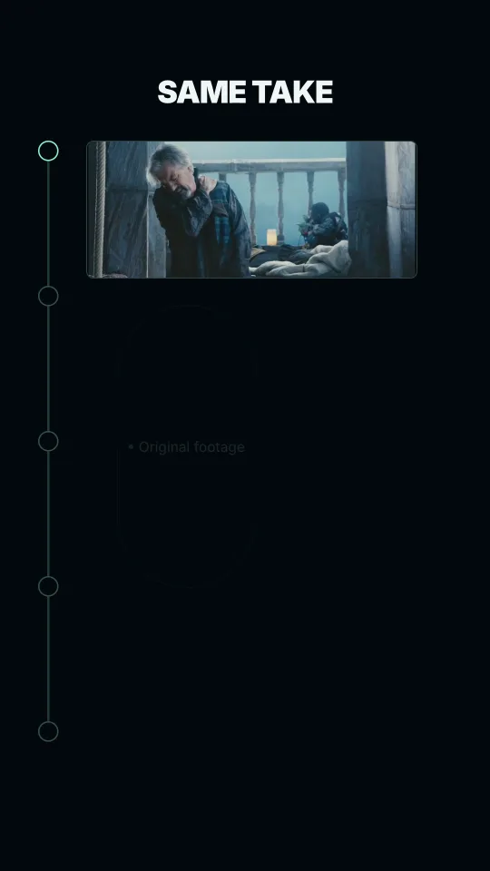](media/recastroom-hero-9x16.mp4)

### Source-versus-recast comparison

[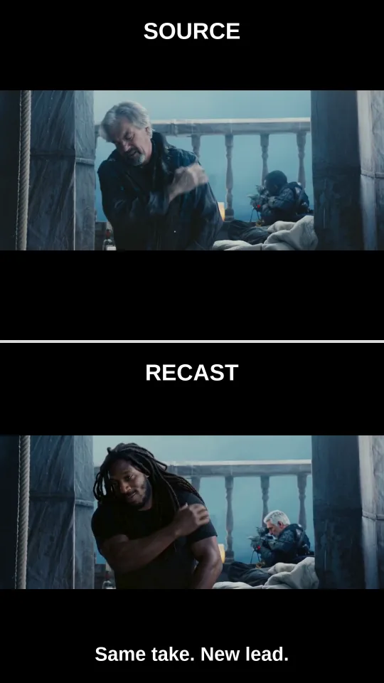](media/recastroom-proof-9x16.mp4)

### Additional user previews

| 16:9 | Vertical | Square |
|---|---|---|
| [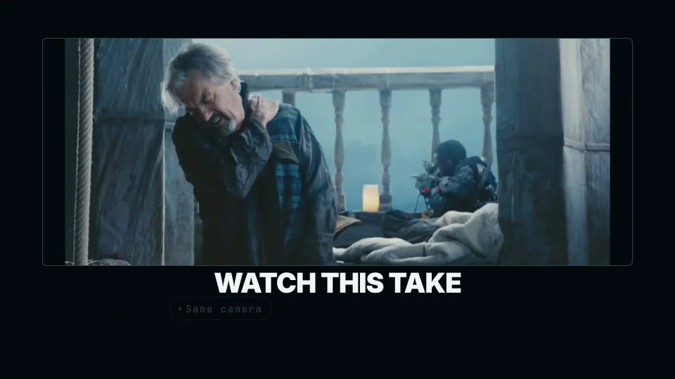](media/recastroom-teaser-6s-16x9.mp4) | [](media/recastroom-teaser-6s-9x16.mp4) | [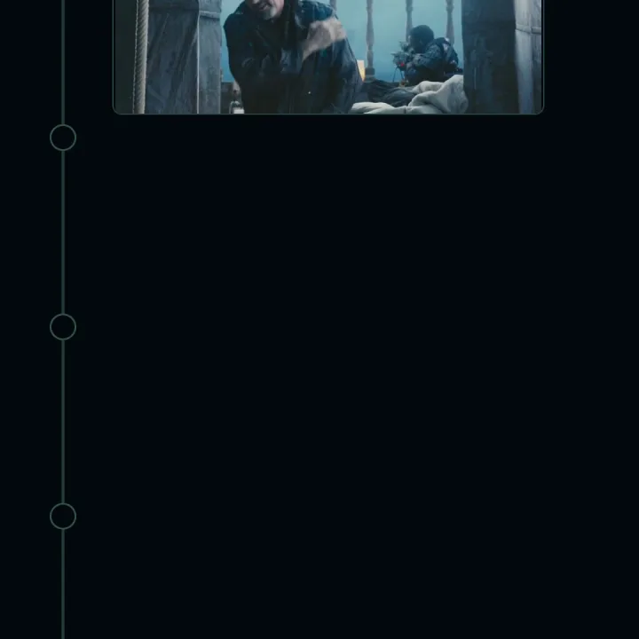](media/recastroom-teaser-6s-square.mp4) |

### Diagrams

| Workflow | Architecture | Media overview |
|---|---|---|
| [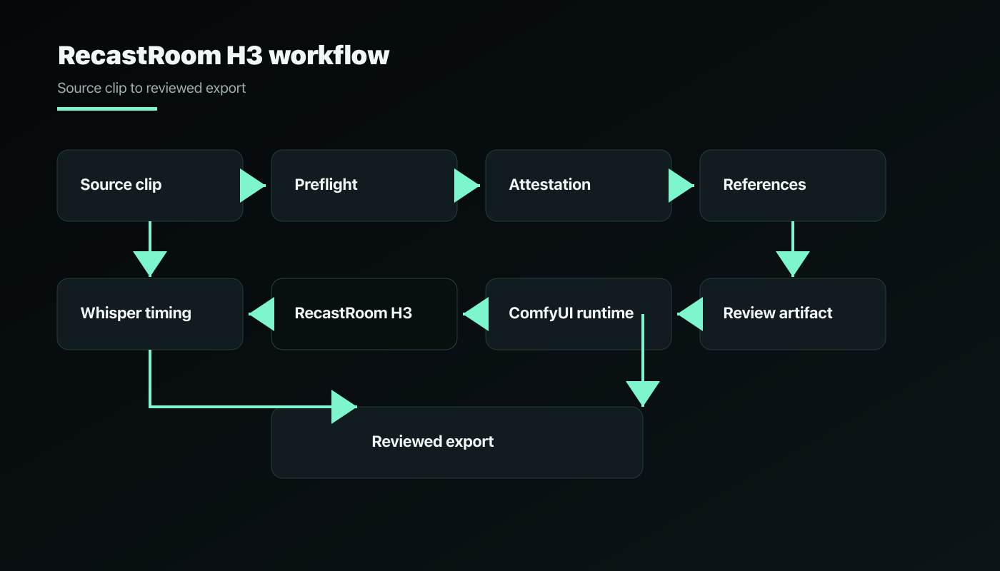](docs/images/workflow-diagram.png) | [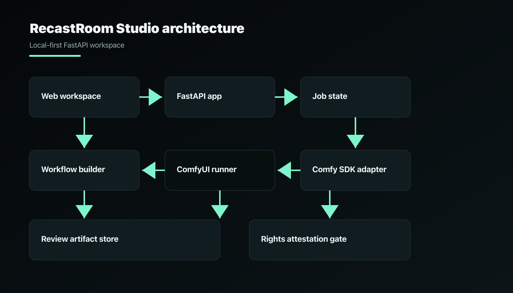](docs/images/architecture-diagram.png) | [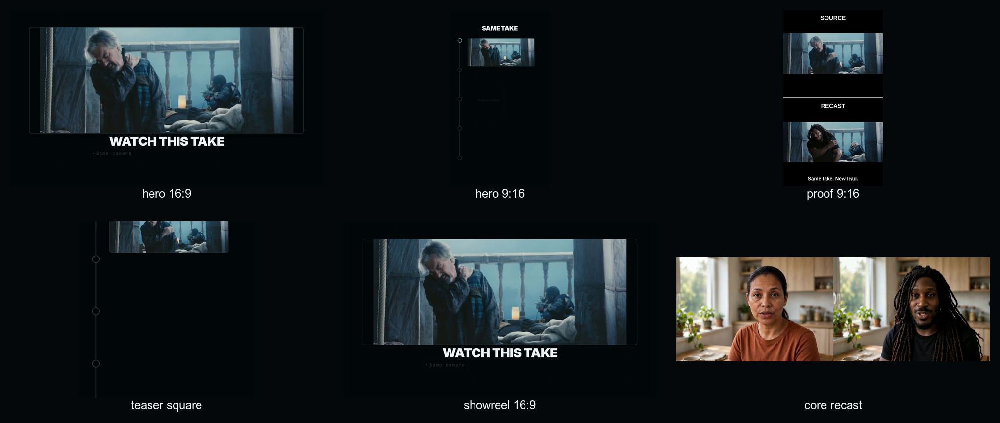](docs/images/media-contact-sheet.jpg) |

The full inventory and hashes are in [`media/README.md`](media/README.md).

## Quickstart

Install FFmpeg first. macOS users can run `brew install ffmpeg`; Ubuntu users can run `sudo apt-get install ffmpeg`.

Fastest local path:

```bash
./setup.sh
./run.sh
```

`setup.sh` uses **uv** when available and falls back to standard `venv` + `pip`
otherwise.

`run.sh` listens on `127.0.0.1:8768` by default; override it with `PORT=8897`.

Advanced setup, release verification, and HTTP examples are available in
[`docs/QUICKSTART.md`](docs/QUICKSTART.md),
[`docs/RELEASE.md`](docs/RELEASE.md), and
[`docs/API_EXAMPLES.md`](docs/API_EXAMPLES.md).

```bash
python -m venv .venv
source .venv/bin/activate
python -m pip install ".[dev]"

export RECASTROOM_COMFY_URL="http://127.0.0.1:8188"
export RECASTROOM_WORKFLOW="workflows/recastroom_h3_workflow.json"
export RECASTROOM_BACKEND=dry_run

uvicorn app.main:app --reload --port 8768
```

Open:

```text
http://127.0.0.1:8768
```

After first-run setup, the app opens into that workspace. Public overview and
legal notes are linked in the footer.

On first launch, a four-step setup wizard records your connection preference,
guidance level, and review mode. It can be skipped and reopened later. It does
not change server settings or store credentials; the readiness bar shows the
connection the server is actually using.

## Repository guide

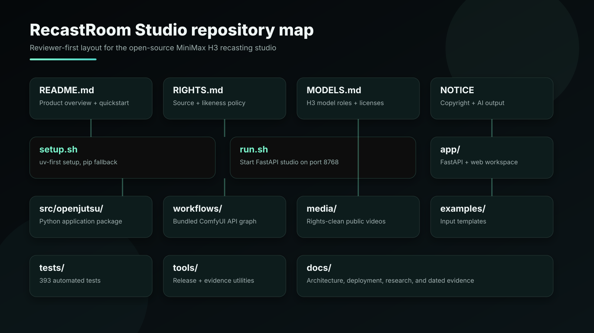

```text
README.md              Product overview and quickstart
RIGHTS.md              Source, likeness, and model rights policy
MODELS.md              Model files, roles, and licenses
NOTICE                 Copyright, model redistribution, and AI-output notice
setup.sh               Local environment setup
run.sh                 Start the FastAPI studio on 127.0.0.1:8768
app/                   FastAPI server and static web workspace
src/openjutsu/         Python application package
workflows/             Bundled RecastRoom H3 workflow
media/                 Public hero and comparison videos
examples/              Input templates and permission example
scripts/               Local trial and CLI helpers
tests/                 Application, API, workflow, and browser regression tests
tools/                 Release and verification utilities
docs/                  Architecture, deployment, and product documentation
```

## CLI

After installing the package, use the `recastroom` entry point.

Inspect a clip:

```bash
recastroom inspect path/to/source.mp4
```

Extract word timings with local Whisper:

```bash
recastroom words path/to/source.mp4 --json path/to/words.json
```

Prepare a runnable workflow:

```bash
recastroom prepare \
  --attest-rights \
  --source source.mp4 \
  --reference-1 character-front.png \
  --reference-2 character-three-quarter.png \
  --identity "the target performer shown in the reference images" \
  --words words.json \
  --output work/prepared.json
```

Queue to a local ComfyUI API:

```bash
recastroom run --attest-rights work/prepared.json
```

The CLI also requires `--attest-rights` before queueing a workflow. This records
your permission confirmation; it does not investigate ownership or prove consent.

## Architecture

```text
original clip
  -> clip and timing check
  -> new lead reference
  -> permission confirmation
  -> RecastRoom MiniMax H3 workflow
  -> configured Comfy service
  -> original dialogue restored
  -> before/after review and job summary
```

The FastAPI app owns validation and job state. The web client reports readiness and review state without claiming an automated quality score. FFmpeg handles probing, remuxing, and review renders. The bundled workflow keeps identity, performance, scene, and audio as separate responsibilities.

## Rights policy

RecastRoom Studio is for clips you own, clips you are licensed to use, or clips you have explicit permission to modify.

The UI requires permission confirmation before a job can start. The repository must not ship:

- unlicensed film or television footage,
- celebrity or public-figure likenesses without consent,
- clips of deceased performers without estate consent,
- non-consensual sexual, political, harassing, or deceptive media.

See [`RIGHTS.md`](RIGHTS.md) and [`examples/PERMISSION_DECLARATION.md`](examples/PERMISSION_DECLARATION.md).

## Troubleshooting

| Symptom | Fix |
|---|---|
| Render connection unavailable | Start ComfyUI and confirm `RECASTROOM_COMFY_URL` points to it |
| Preparation returns 422 | Check that the clip is supported and the permission box is checked |
| Dialogue timing fails | Confirm the CLI can read the file and that it contains audible speech |
| Browser preview is blank | Use an MP4 or MOV preview; the server can still inspect other supported containers |
| Hosted run reports missing credentials | Set `COMFY_API_KEY` and `COMFY_BASE_URL` for your hosted Comfy setup |

## Limitations

- RecastRoom does not prove legal clearance; it records your permission confirmation.
- The public demo path still requires footage and references you are allowed to use.
- Hosted rendering needs your credentials and configured deployment.
- You approve the final video and audio; no automated score replaces playback.
- The current workflow is tuned for one person in one continuous dialogue shot, not arbitrary multi-shot scenes.

## Contest alignment

RecastRoom Studio is built for Comfy's **#OpenSourceHiggsfield** challenge as
one focused MiniMax H3 recasting studio: one permitted continuous dialogue shot,
the new lead’s reference, dialogue timing, original-audio restoration, a
permission checkpoint, and a reproducible Comfy workflow.
It is not an attempt to recreate every feature of a broad commercial video
platform.

The public demo must use owned, licensed, or original footage. The private film/TV experiments that informed the workflow will not be included in the repository.
