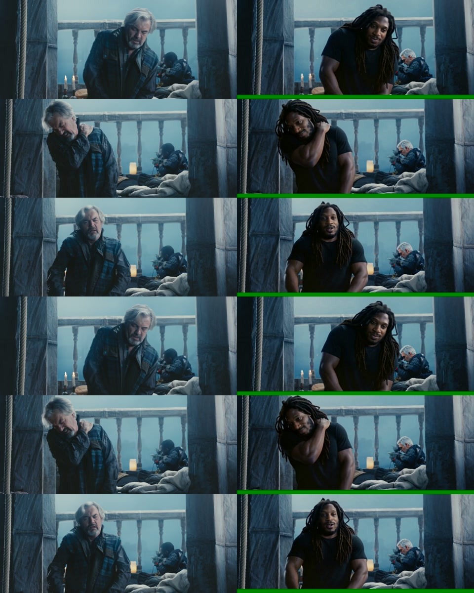

# Official Comfy API SDK execution proof

This run used RecastRoom's `openjutsu.comfy_sdk_runner.ComfySdkRunner`, not a provider bypass script.

| Item | Value |
|---|---|
| SDK | `comfy-sdk 0.5.0` |
| Build CLI | `comfy-cli 1.24.0` |
| Build | `56aad298-7715-42a7-b377-a799051b6a2e` |
| Release | version 2, `ef64ae9a-990a-4b26-945b-44f659ab5edf` |
| Job | `233a17e4-253f-4797-baa6-f82a2b3bbbc8` |
| Result | `succeeded` |
| Output node | `751` |
| Active window | 128 seconds, submission to downloaded output |
| Teardown | temporary deployment deleted |

## Result

[Watch the final SDK render](final.mp4)

[Watch source versus result](source_vs_final.mp4)

The source clip is an eight-second excerpt from the CC BY 3.0 film _Tears of Steel_. The replacement likeness reference was owner-provided for this technical demo.

## Verified properties

- Output: 960×384 H.264, 24 fps, 8 seconds.
- Generated MP4 SHA-256: `f8ed7bcee8f9c2eb83f26d83c763d563e75a3625a1a08829ba32541399dabab8`.
- Final source-audio MP4 SHA-256: `3962bb606e04443eb116dde19330d7ed6dc15d3ebd7a516d01b5a32d47738333`.
- Decoded source and final audio PCM SHA-256 match exactly: `ed03c8bfffaaf93f9b4cd90dcb1d63401ca39c358abfd0af4cef3562f9621d54`.
- The visual contact sheet shows the requested identity replacement; playback review remains the owner's final quality gate.

## What failed first

The first hosted attempt, job `6cad5313-84db-441e-b9b5-152644a9d480`, failed before execution because the workflow requested the Turbo LoRA by its root filename while release 1 staged it under `loras/experimental/`. Commit `c1c331c6068dee313d813ec92093335f27b9bce8` moved the Build placement to `models/loras/` and aligned the canonical workflow and hash pins. Release 2 then completed the real render above.

## Accounting boundary

The CLI exposed a $27.02 balance before and immediately after the run. It did not expose a settled Comfy API deployment invoice, so this evidence does not claim exact final spend. The temporary deployment was deleted immediately after output download to stop compute and storage charges.
